# ScholarMind

学术论文辅助阅读系统 · An academic paper reading assistant

**在线 Demo / Live demo：** <https://qingshengnangong.com/scholarmind/>（需要自备 Gemini API Key / bring your own Gemini API key）

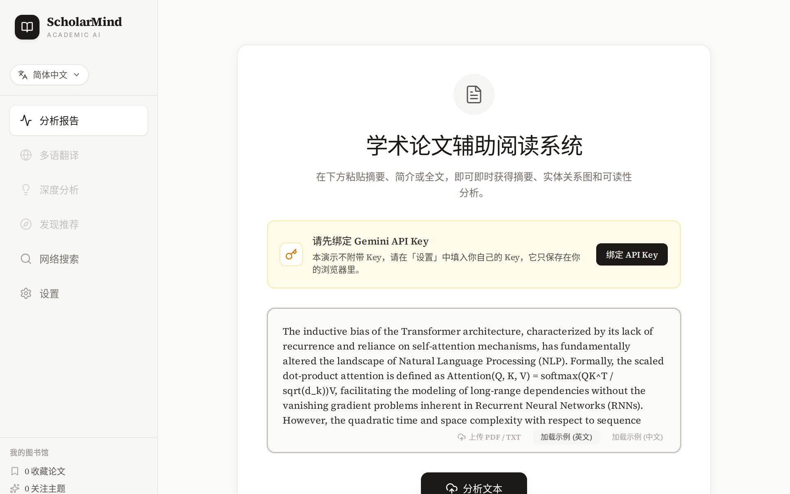

[中文](#中文) · [English](#english) · [使用示例 / Examples](#使用示例--examples)

---

## 中文

ScholarMind 是《自然语言处理（英语）》课程的期末项目（2025.12 – 2026.01），帮助读者快速理解一篇中英文学术文本。项目分为两部分：

| 目录 | 内容 | 分析方式 |
|---|---|---|
| [`python/`](python/) | 命令行程序 | 本地运行，基于 spaCy 的规则与统计方法 |
| [`web/`](web/) | 网页版（即在线 Demo） | 调用 Google Gemini 大模型 |

### 功能

**Python 命令行版**
- 自动摘要：TextRank 抽取式摘要；可选接入 OpenAI 兼容接口生成摘要。
- 实体识别：spaCy NER，加上针对学术术语的规则补充。
- 概念图谱：依存句法抽取主谓宾三元组，用 NetworkX 构建有向图并可视化。
- 术语定义抽取、关键词提取、文本概况统计（TTR、hapax 等）与阅读难度评估。
- 中英文自动识别，切换 `en_core_web_lg` / `zh_core_web_lg` 模型；结果可导出为 JSON。

处理流程见 [`docs/pipeline.png`](docs/pipeline.png)。

**网页版**
- 摘要、实体、关键词、可读性评分与交互式概念图谱（D3）。
- 多语翻译、深度阅读分析、相关论文推荐与网络搜索（Google Search grounding）。
- 针对当前论文的问答，支持上传 PDF / TXT，界面提供中、英、日、韩四种语言。
- 深度分析可改用任意 OpenAI 兼容接口。

各功能的界面截图见[使用示例](#使用示例--examples)。

### 快速开始

**Python 版**（Python 3.10 及以上）

```bash
cd python
pip install -r requirements.txt
python -m spacy download en_core_web_lg
python -m spacy download zh_core_web_lg   # 分析中文文本时需要
python scholarmind.py
```

进入交互模式后，输入 `demo` 或 `demo_zh` 查看示例，也可以直接输入文本或文件路径。输入 `ai` 可配置 OpenAI 兼容接口，`quit` 退出。图谱里的中文标签需要先为 Matplotlib 配置中文字体。

**网页版**（Node.js 18 及以上）

```bash
cd web
npm install
npm run dev      # 开发服务器 http://localhost:3000/scholarmind/
npm run build    # 生成 dist/
```

### API Key 与隐私

网页版不附带任何 Key。使用者在「设置」中填入自己的 Gemini API Key（可在 [Google AI Studio](https://aistudio.google.com/apikey) 免费申请），Key 只保存在浏览器本地。请求由浏览器直接发往 Google，或发往使用者自己填写的兼容代理，Demo 所在的服务器既拿不到 Key，也看不到提交的文本。在无法直连 Google 的网络环境下，需要填写代理地址才能使用。

### 技术栈

Python 版：spaCy、NetworkX、NumPy、Matplotlib。
网页版：React 19、TypeScript、Vite、Tailwind CSS、D3、Recharts、pdf.js、Google Gen AI SDK。网页原型最初由 Google AI Studio 生成，之后改为本地构建，加入了自带 Key 机制、手机端布局和错误提示。

---

## English

ScholarMind is the final project for a *Natural Language Processing (in English)* course (Dec 2025 – Jan 2026). It helps readers get through academic texts in English or Chinese. The repository has two parts:

| Folder | What it is | How it analyses text |
|---|---|---|
| [`python/`](python/) | Command-line program | Runs locally, with rule-based and statistical methods on spaCy |
| [`web/`](web/) | Web app (the live demo) | Calls Google Gemini |

### Features

**Python CLI**
- Summarisation: extractive TextRank summaries, with optional LLM summaries through any OpenAI-compatible endpoint.
- Entity recognition: spaCy NER plus rules for academic terminology.
- Concept graph: subject–verb–object triples from dependency parses, built into a directed NetworkX graph and plotted.
- Definition extraction, keyword extraction, text statistics (TTR, hapax and more) and a reading-difficulty score.
- Automatic English/Chinese detection that switches between `en_core_web_lg` and `zh_core_web_lg`; results export to JSON.

The pipeline is drawn in [`docs/pipeline.png`](docs/pipeline.png).

**Web app**
- Summary, entities, keywords, readability score and an interactive D3 concept graph.
- Translation, deep-reading analysis, related-paper discovery and web search (Google Search grounding).
- Chat with the paper, PDF/TXT upload, and a UI in English, Chinese, Japanese and Korean.
- Deep analysis can run on any OpenAI-compatible endpoint instead.

Screenshots of each feature are under [Examples](#使用示例--examples).

### Getting started

**Python** (3.10 or later)

```bash
cd python
pip install -r requirements.txt
python -m spacy download en_core_web_lg
python -m spacy download zh_core_web_lg   # only for Chinese text
python scholarmind.py
```

In the interactive prompt, type `demo` or `demo_zh` for a sample run, or paste text or a file path. Type `ai` to configure an OpenAI-compatible endpoint and `quit` to exit. Chinese labels in the graph need a CJK font configured for Matplotlib.

**Web app** (Node.js 18 or later)

```bash
cd web
npm install
npm run dev      # dev server at http://localhost:3000/scholarmind/
npm run build    # outputs dist/
```

### API key and privacy

The web app ships without a key. Users paste their own Gemini API key in Settings (free from [Google AI Studio](https://aistudio.google.com/apikey)). The key is stored only in their browser. Requests go from the browser straight to Google, or to a compatible proxy the user enters, so the server hosting the demo never sees the key or the submitted text. Where Google is unreachable, a proxy address is required.

### Tech stack

Python: spaCy, NetworkX, NumPy, Matplotlib.
Web: React 19, TypeScript, Vite, Tailwind CSS, D3, Recharts, pdf.js and the Google Gen AI SDK. The web prototype was first generated with Google AI Studio, then moved to a local build with bring-your-own-key, a phone layout and clearer error messages.

---

## 使用示例 / Examples

截图摄于 2026 年 1 月，分析对象是一段讨论语义学任务的英文文本。此后「设置」页新增了 Gemini API Key 绑定，默认模型也改为从 Key 可用的模型中选择，其余界面基本相同。

The screenshots date from January 2026 and analyse an English passage on the task of semantics. Since then the Settings page has gained a Gemini API key section, and the default models are now chosen from those the key can use. The rest of the interface is largely unchanged.

### 1. 首页 · Home

粘贴摘要、简介或全文，也可以上传 PDF / TXT 或加载内置示例，然后点「分析文本」。

Paste an abstract, an introduction or the full text, upload a PDF or TXT file, or load a built-in sample, then click Analyze Text.

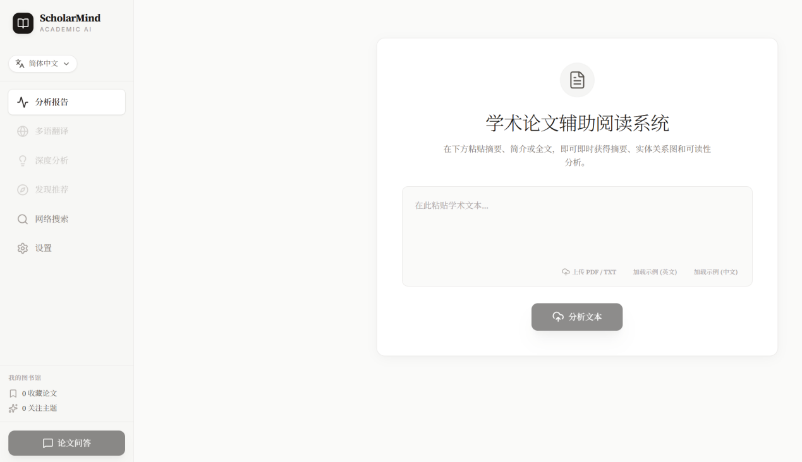

### 2. 分析报告 · Analysis report

核心摘要与关键词，可读性评分及说明，以及平均句长、术语密度、实体分布和关键词相关度。

A core summary with its keywords, a readability score with a short explanation, mean sentence length, term density, entity distribution and keyword relevance.

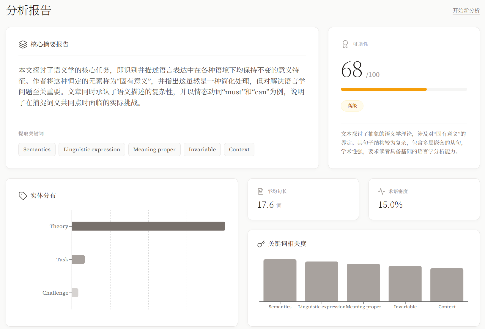

### 3. 知识图谱 · Knowledge graph

文本中的概念及其关系，以力导向布局绘制，节点可拖动，画布可缩放。

Concepts from the text and how they relate, in a force-directed layout. Nodes can be dragged and the canvas zoomed.

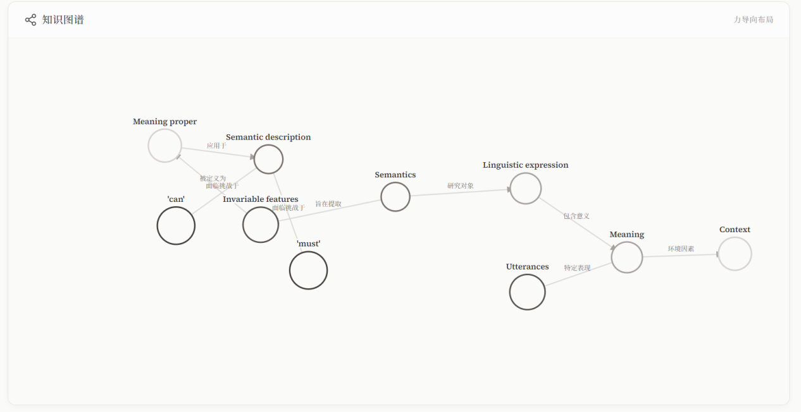

### 4. 关键实体分析 · Key entities

列出每个实体的类别和出现频率。

Each entity with its category and frequency.

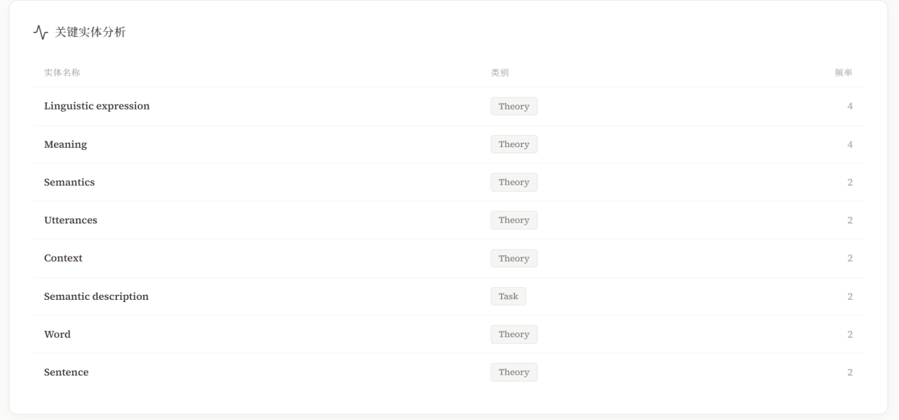

### 5. 多语翻译 · Translation

原文与译文左右对照，可译成 7 种语言，图中为日语。

The original and the translation side by side. There are seven target languages; this one is Japanese.

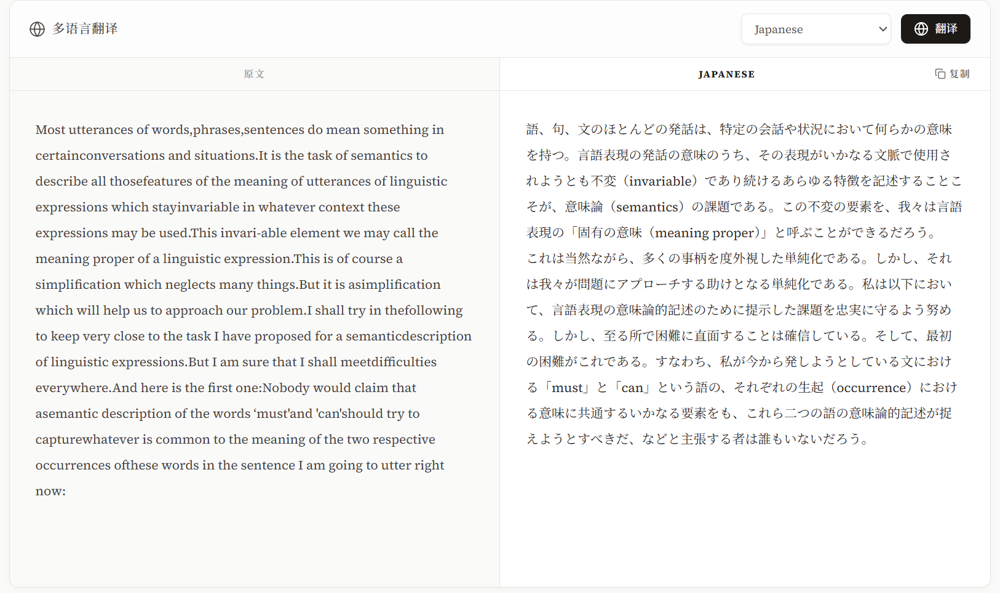

### 6. 相关论文 · Related papers

根据文本关键词，通过 Google 搜索推荐相关论文，可收藏到「我的图书馆」。

Related papers found through Google Search from the text's keywords. Each can be saved to My Library.

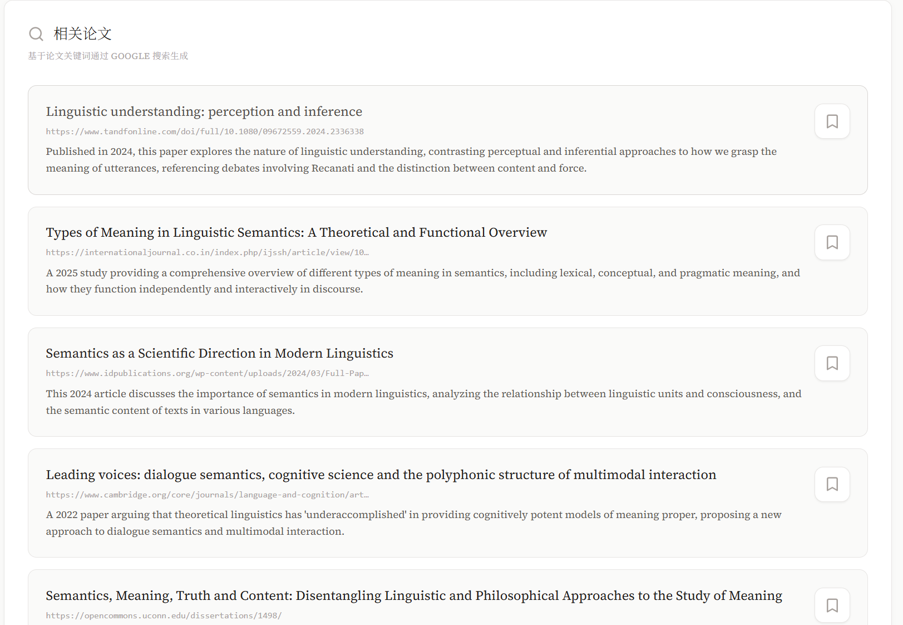

### 7. 深度阅读分析 · Deep reading analysis

模型以导师的口吻讲解阅读难点，并给出阅读建议和拓展知识，结果可导出为 Markdown 或 TXT。

The model acts as a tutor: it explains the hard parts, suggests how to read the text and adds related background. The result exports to Markdown or TXT.

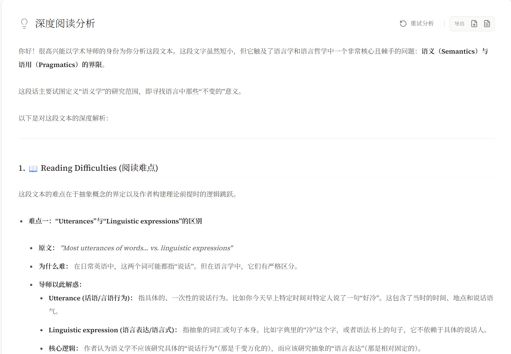

### 8. 网络搜索 · Web search

检索疑难词或概念，答案依据 Google 搜索结果整理。

Look up a difficult term or concept. The answer is grounded in Google Search results.

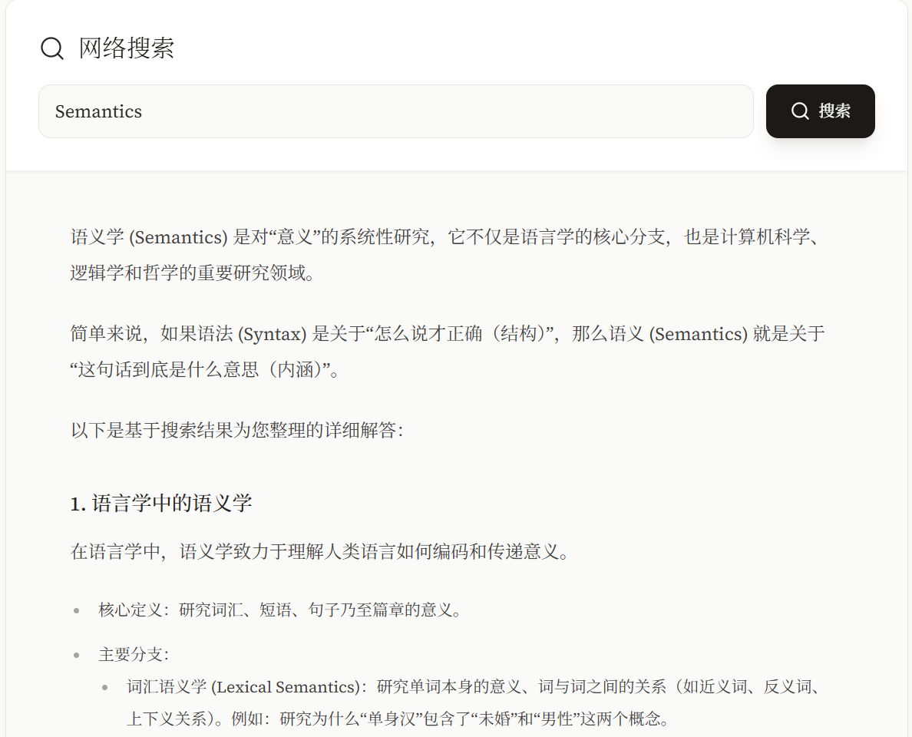

### 9. 检索来源 · Sources

回答下方列出所引用的网页，每一条都能点开核对，来源可以追溯。

Below each answer are the web pages it drew on, each a link you can follow to check.

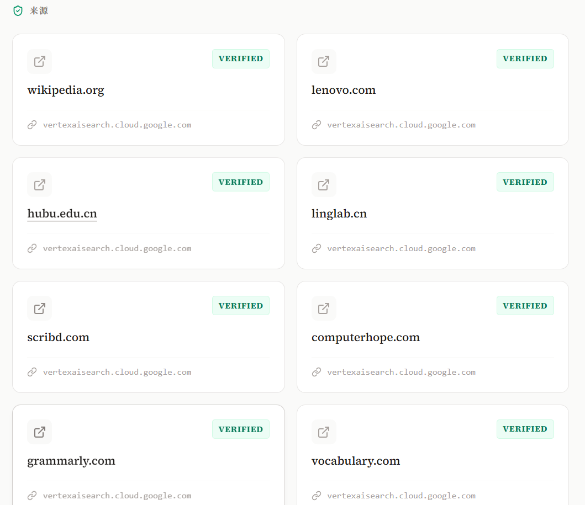

### 10. 自定义 AI 配置 · Custom AI configuration

在「设置」中填入任意 OpenAI 兼容接口的地址和密钥，点「检测模型列表」后选择模型。

In Settings, enter the base URL and key of any OpenAI-compatible API, click Check Model List and pick a model.

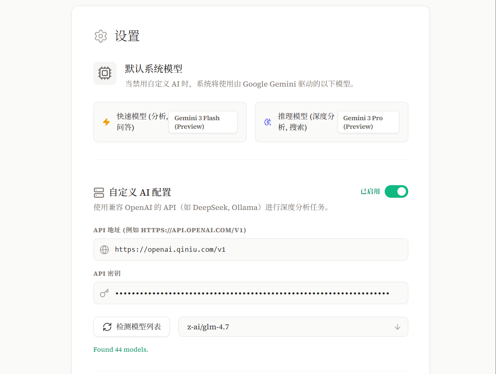

### 11. 用自己的接口做深度分析 · Deep reading on your own API

启用后，深度阅读分析改由所选模型生成，标题下注明所用模型，图中为 z-ai/glm-4.7。

Once enabled, deep reading analysis runs on the chosen model, which is named under the heading (z-ai/glm-4.7 here).

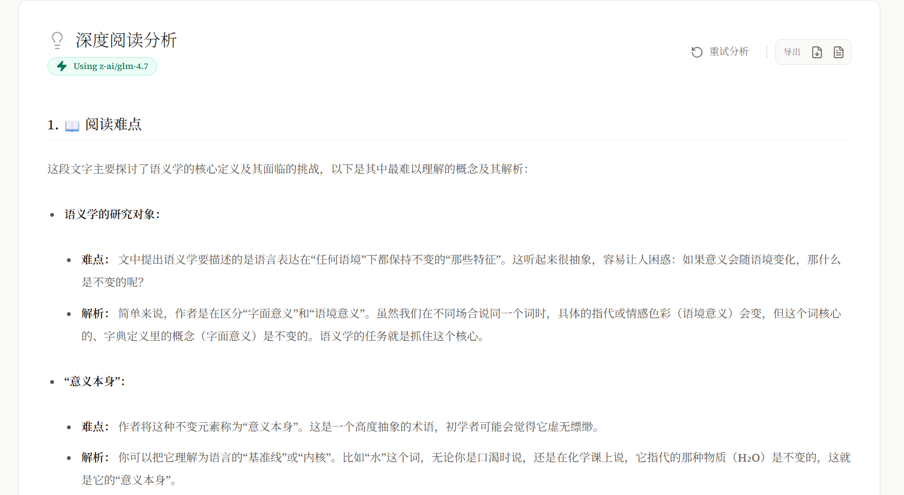

---

## License

[MIT](LICENSE) © 2025-2026 Mingtao Xia
